# S3FastBrowser

**A fast, self-hosted web browser for S3-compatible object storage.**

S3FastBrowser is a small Flask application that lets you connect to any S3-compatible
endpoint (AWS S3, MinIO, Ceph RGW, NetApp StorageGRID, Wasabi, Backblaze B2, ...) and
browse, search, preview, upload, download and delete objects from a single web page.
It also understands object versions and delete markers, shows metadata and tags,
creates presigned links and edits bucket policies and lifecycle rules.

It runs as one container, keeps your S3 credentials on the server (never in the
browser), works fully offline (all assets are bundled), and ships with a **demo mode**
backed by a local MinIO filled with generated sample files, so you can try it in a
minute without touching real data.

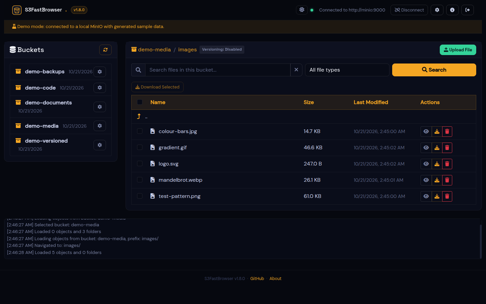

## Features

- **Any S3-compatible endpoint.** Path-style or virtual-hosted addressing, any region,
  optional bucket for bucket-scoped keys, recent connections remembered per session.
- **Fast browsing.** Native S3 pagination (`list_objects_v2` with continuation tokens),
  folders from common prefixes, breadcrumbs, configurable page size, jump to last page.
- **Search** by name and/or extension under the current prefix.
- **Previews** for images, PDF, video, audio, text, Markdown, logs, source code, JSON,
  CSV, Excel, HTML (sandboxed), RTF and a hex dump for anything else. Previews are
  [plugins](docs/PLUGINS.md): add your own by dropping a Python file in a folder.
- **Uploads** of single files, many files or whole folders (drag and drop), with
  per-file progress, configurable concurrency and multipart thresholds.
- **Downloads** of single objects (presigned URL or proxied through the app), any
  selection or folder as a **streamed ZIP** (no temporary files, constant memory), or
  straight into a local folder with the File System Access API (Chromium browsers).
- **Versioning.** Version history per object, download any version, show delete
  markers, restore an object by removing its delete marker, or delete every version
  permanently.
- **Object details.** Size, type, ETag, storage class, user metadata, tags, and
  **presigned URLs** with a chosen lifetime (up to 7 days).
- **Bucket settings.** View, edit and delete the bucket policy and lifecycle rules
  (JSON editor and table view).
- **Security.** Optional built-in login, endpoint allowlist against SSRF, server-side
  sessions, strict security headers, everything bound to localhost by default. See
  [Security](#security).
- Light and dark themes.

| Image preview | Video preview |
|---|---|
| 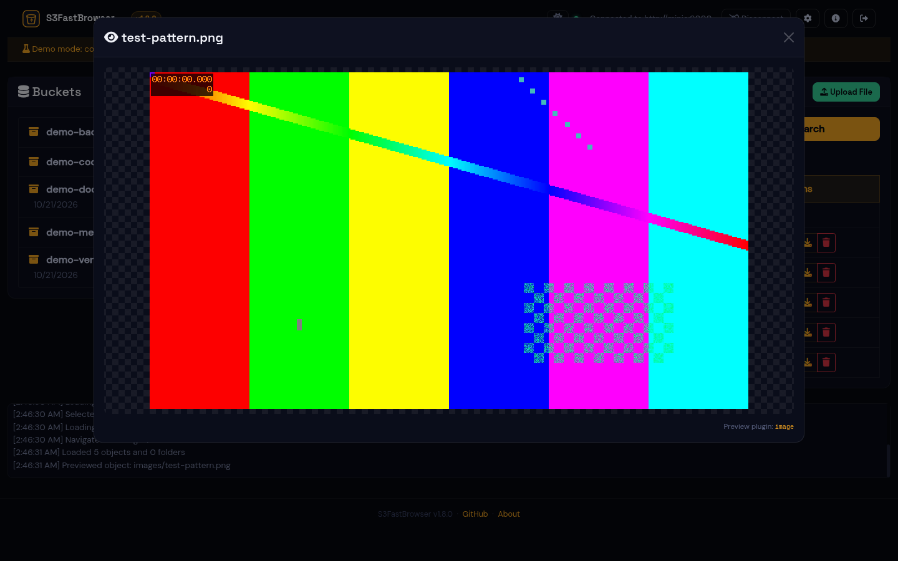 | 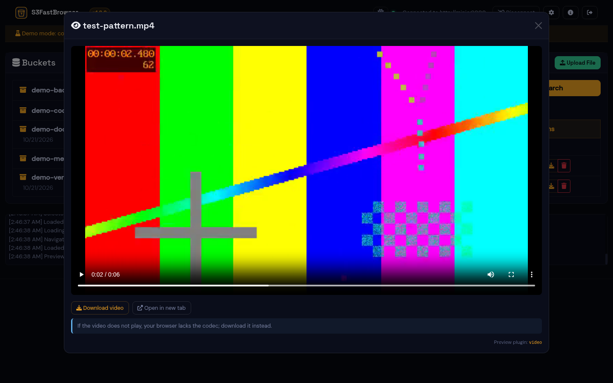 |

| PDF preview | Spreadsheet preview |
|---|---|
| 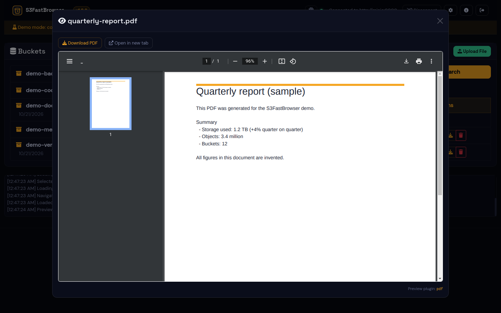 | 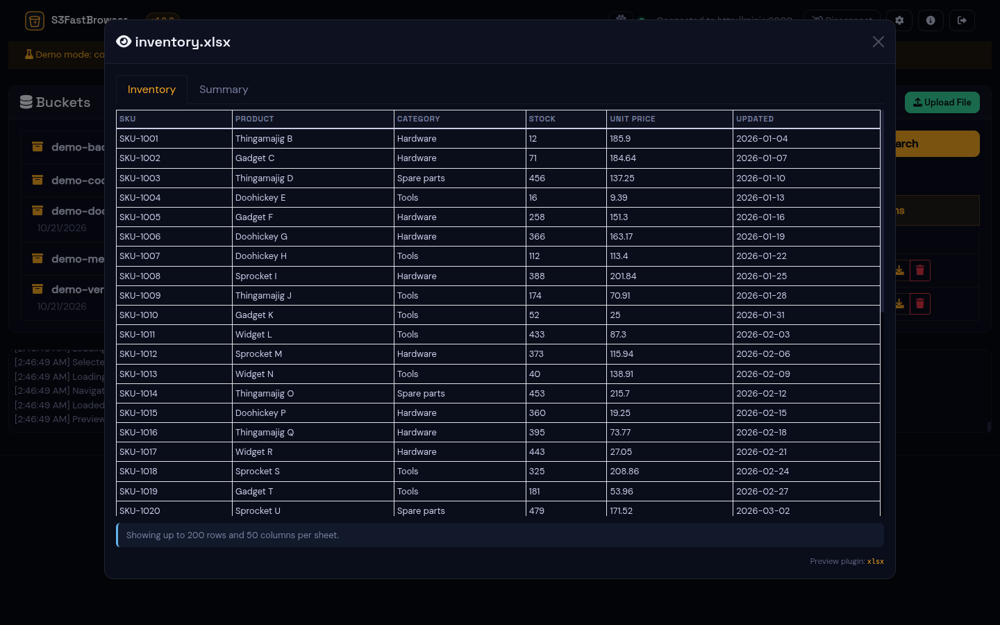 |

| Object details and presigned URL | Versions |
|---|---|
| 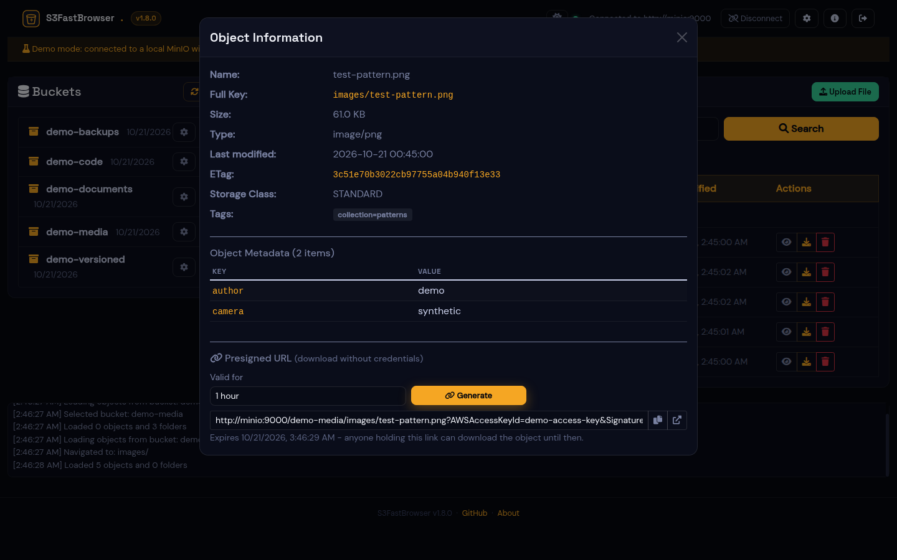 | 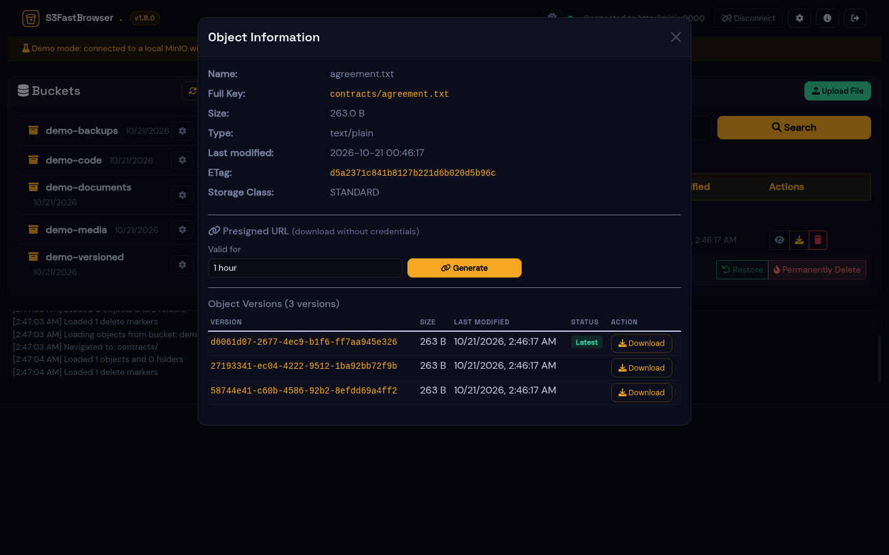 |

| Upload | Search |
|---|---|
| 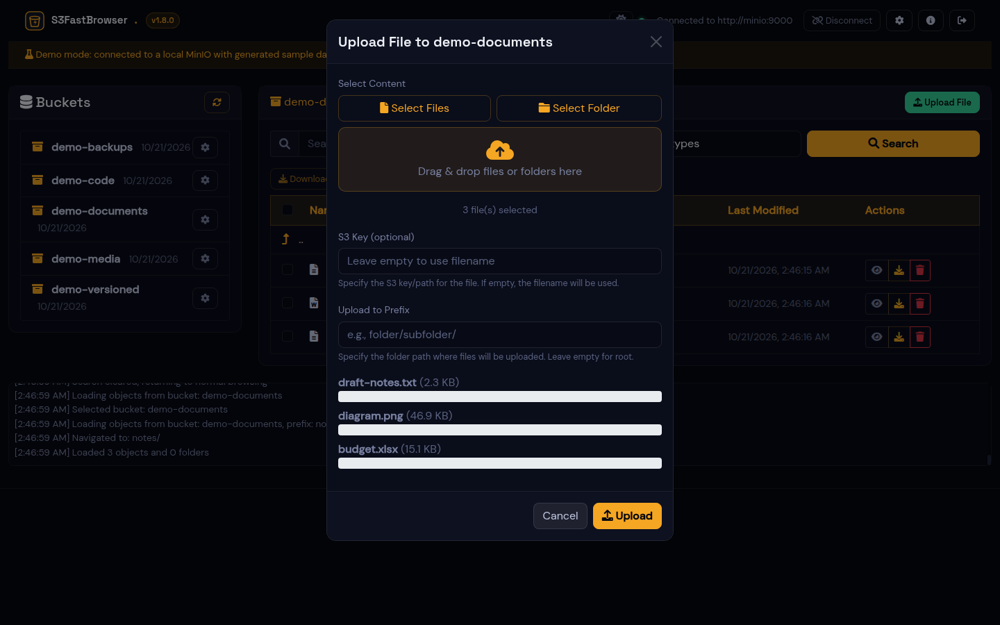 | 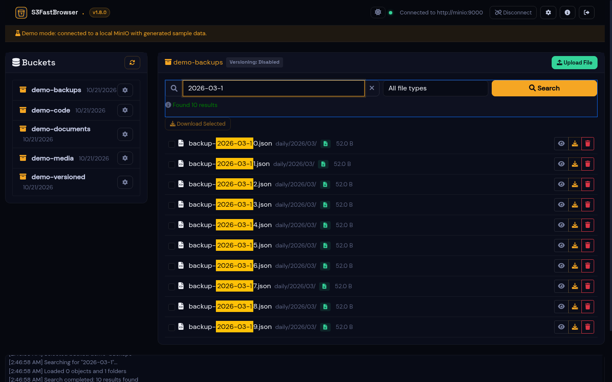 |

| Delete markers | Bucket policy and lifecycle |
|---|---|
| 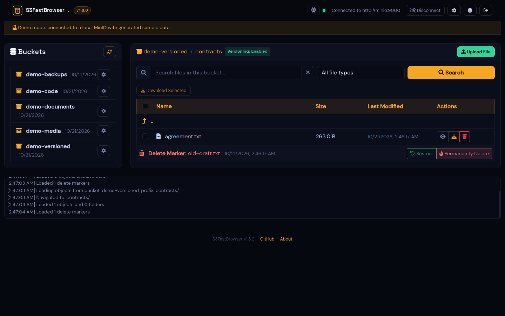 | 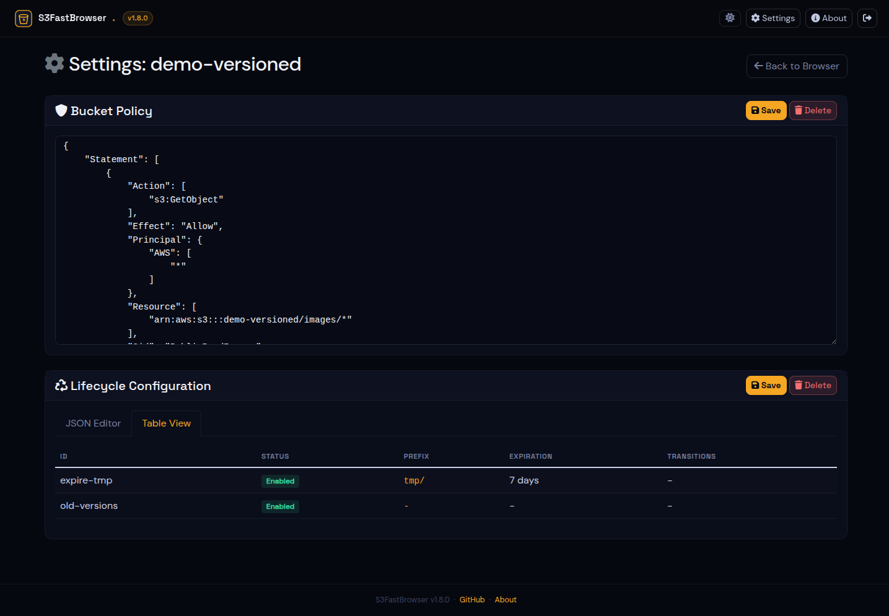 |

| Settings | Light theme |
|---|---|
| 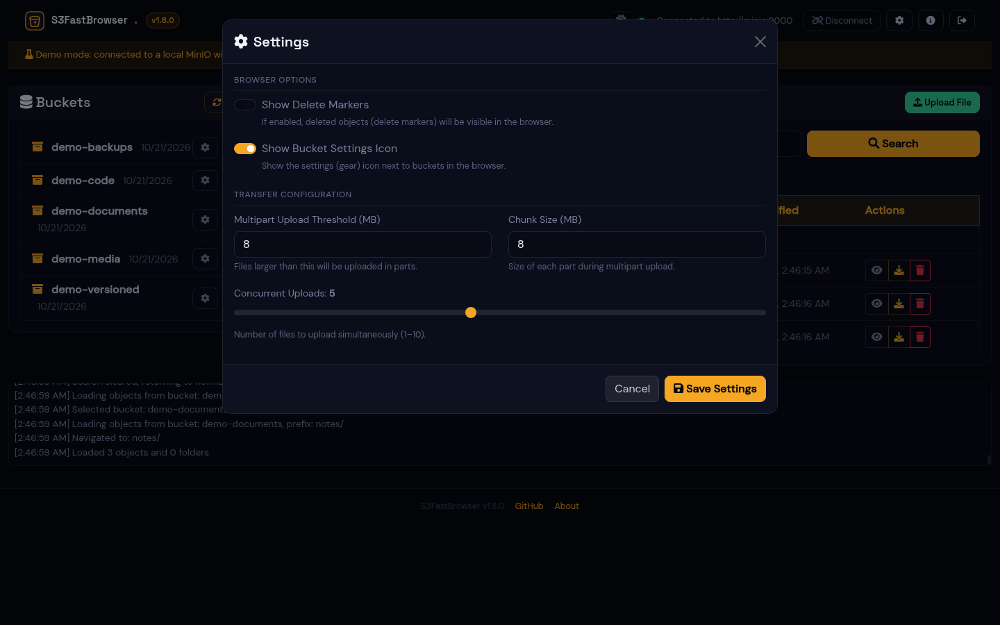 | 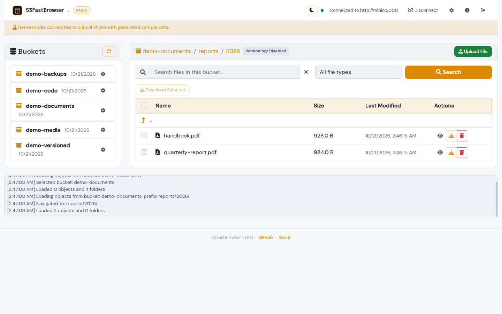 |

Every preview type has its own screenshot in [docs/PREVIEWS.md](docs/PREVIEWS.md).
*All screenshots come from demo mode: every bucket, file and value in them is generated.*

## Quick start (Docker)

```bash
git clone https://github.com/mmiretta/s3fastbrowser.git
cd s3fastbrowser
cp .env.example .env
# edit .env: set SECRET_KEY and S3FB_AUTH_PASSWORD (and S3FB_ALLOWED_ENDPOINTS if others will use it)
docker compose up -d --build
```

Open <http://127.0.0.1:5001>, sign in (if you set a password), enter the access key,
secret key, endpoint URL and region of your storage and click **Connect**.

The port is published on `127.0.0.1` only. To make S3FastBrowser available to other
people, read [docs/DEPLOY.md](docs/DEPLOY.md): it covers TLS with Caddy or nginx,
authentication, the endpoint allowlist, upgrades and backups.

## Demo mode

The demo needs nothing but Docker:

```bash
docker compose --profile demo up -d --build s3fastbrowser-demo
# open http://127.0.0.1:5002 and sign in with demo / demo, then "Open the demo storage"
```

This starts three extra containers:

| Service | What it does |
|---|---|
| `minio` | A local MinIO (community build), only reachable from the other containers |
| `demo-seed` | One-shot job that creates five buckets and fills them with generated files: ffmpeg test-pattern images, videos and tones, a hand-written PDF, spreadsheets, code, logs, an HTML page, a versioned bucket with a delete marker, a bucket policy and lifecycle rules |
| `s3fastbrowser-demo` | S3FastBrowser with `S3FB_DEMO=true`, login `demo` / `demo`, the allowlist limited to the demo MinIO and downloads proxied through the app |

Nothing in the demo is real data. Remove it with
`docker compose --profile demo down -v` (on a checkout that also runs the real app,
see [docs/DEPLOY.md](docs/DEPLOY.md#9-demo-stack-on-a-server) instead: `down -v` removes
every volume of the project).

The screenshots in this repository are produced from the demo with
[`scripts/screenshots.py`](scripts/screenshots.py) (Playwright).

## Running without Docker

```bash
python3 -m venv .venv && . .venv/bin/activate
pip install -r requirements.txt
cp .env.example .env            # optional
python run.py                   # development server on http://127.0.0.1:5001
```

For production use gunicorn (as the Docker image does):
`gunicorn --chdir src --worker-class gthread --workers 2 --threads 8 -b 127.0.0.1:5001 'app:create_app()'`.

## Configuration

All settings are environment variables (or lines in `.env`). See
[`.env.example`](.env.example) for a commented template.

| Variable | Default | Description |
|---|---|---|
| `SECRET_KEY` | *(random per start)* | Flask secret. Set it to a long random string. |
| `S3FB_AUTH_USERNAME` | `admin` | User name for the built-in login |
| `S3FB_AUTH_PASSWORD` | *(empty)* | Enables the built-in login with this password |
| `S3FB_AUTH_PASSWORD_HASH` | *(empty)* | Same, with a hash (`python src/auth.py hash-password`). Takes precedence over the plain password. |
| `S3FB_AUTH_DISABLED` | `false` | Declare that another layer (SSO proxy, VPN) authenticates every request; silences the warning banner |
| `S3FB_ALLOWED_ENDPOINTS` | *(empty = any)* | Comma-separated allowlist of endpoint URLs or patterns, e.g. `https://s3.*.amazonaws.com,https://minio.example.com` |
| `S3FB_DEFAULT_ENDPOINT` | `https://s3.amazonaws.com` | Pre-filled endpoint in the connection form |
| `S3FB_DEFAULT_REGION` | `us-east-1` | Pre-filled region |
| `S3FB_VERIFY_TLS` | `true` | Verify the S3 endpoint's TLS certificate |
| `S3FB_CA_BUNDLE` | *(empty)* | CA bundle for endpoints signed by a private CA |
| `S3FB_DOWNLOAD_MODE` | `presigned` | `presigned`: browser downloads from the endpoint. `proxy`: downloads stream through the app (use when browsers cannot reach the endpoint). |
| `S3FB_PREVIEW_MAX_MB` | `25` | Largest object a whole-file preview (image, Excel, JSON...) may read |
| `S3FB_PLUGIN_DIRS` | *(empty)* | Extra directories with preview plugins, separated by `:` |
| `S3FB_TRUST_PROXY` | `false` | Trust `X-Forwarded-*` headers from a reverse proxy |
| `SESSION_COOKIE_SECURE` | `false` | Send the session cookie over HTTPS only (set to `true` behind TLS) |
| `PERMANENT_SESSION_LIFETIME` | `28800` | Session lifetime in seconds |
| `S3FB_DATA_DIR` | `./data` (`/data` in Docker) | Server-side sessions |
| `LOG_LEVEL` / `LOG_FILE` | `INFO` / *(stdout only)* | Logging |
| `GUNICORN_WORKERS` / `GUNICORN_THREADS` / `GUNICORN_TIMEOUT` | `2` / `8` / `300` | Docker image only |
| `S3FB_BIND` / `S3FB_PORT` | `127.0.0.1` / `5001` | Published address and port (docker-compose) |
| `S3FB_DEMO` | `false` | Demo mode (see above) |

Per-user preferences (show delete markers, bucket settings icon, multipart threshold
and chunk size, concurrent uploads) are set from the **Settings** dialog and kept in the
session.

## Security

S3FastBrowser handles live storage credentials and can delete data, so treat it like
an admin console.

- **Authentication.** Set `S3FB_AUTH_PASSWORD` (or better, `S3FB_AUTH_PASSWORD_HASH`)
  to require a login for every page and API call. Failed logins are rate-limited per
  client address. If you put the app behind an SSO proxy (oauth2-proxy, Authelia,
  Authentik...), you can rely on it instead and set `S3FB_AUTH_DISABLED=true`. Without
  either, the UI shows a red warning and the log says so at start-up.
- **Bind to localhost.** The compose file publishes the port on `127.0.0.1` only.
  Expose it through a reverse proxy with TLS, never directly.
- **SSRF.** The server connects to whatever endpoint URL a user types into the
  connection form. On a shared deployment, set `S3FB_ALLOWED_ENDPOINTS` so it can only
  reach your storage, not internal services or cloud metadata addresses. Connection
  errors are deliberately generic so the form cannot be used as a port scanner; the
  details go to the server log.
- **Credentials** live in server-side sessions (`S3FB_DATA_DIR`); the browser only
  gets an opaque, `HttpOnly`, `SameSite=Lax` cookie. Recent connections are listed
  without their secret key. Protect the data volume like a password store, and use
  keys with the least privilege you need (read-only keys work fine for browsing).
- **Content from buckets is untrusted.** Object names, metadata and file contents are
  escaped before display, HTML files are rendered in a sandboxed iframe without
  scripts, and a Content-Security-Policy is sent with every page.
- **Presigned URLs** can be used by anyone who has them until they expire. Keep the
  lifetime short.

Please report vulnerabilities privately; see [SECURITY.md](SECURITY.md).

## How it works

```
Browser ──HTTP──► Flask app (src/app.py) ──boto3──► S3-compatible endpoint
  index.html        ├─ auth.py              optional login
  (Bootstrap,       ├─ services/s3_service  listing, search, versions, ZIP streaming
   no build step)   ├─ preview_plugins/     one module per preview type
                    └─ server-side sessions (cachelib, S3FB_DATA_DIR)
```

- Listing uses `list_objects_v2` with a `/` delimiter, so only one "folder" is read at
  a time, however large the bucket is.
- Search lists everything under the current prefix and filters by name/extension in
  the app (S3 has no server-side search), up to 1000 results.
- ZIP downloads are written to the response as they are produced: memory use does not
  grow with the archive size (there is a 10 GB safety limit per request).
- Video, audio and PDF previews stream from S3 with HTTP Range support, so seeking
  works and only the parts being viewed are transferred.

## Development

```bash
python3 -m venv .venv && . .venv/bin/activate
pip install -r requirements-dev.txt
pytest                       # uses moto, no real S3 needed
FLASK_DEBUG=true python run.py
```

The front end is plain HTML, CSS and JavaScript in `templates/` with vendored
Bootstrap and Font Awesome in `static/vendor/`; there is no build step. See
[CONTRIBUTING.md](CONTRIBUTING.md) and [docs/PLUGINS.md](docs/PLUGINS.md).

## Documentation

- [docs/DEPLOY.md](docs/DEPLOY.md): production deployment, reverse proxy, upgrades, backups
- [docs/PREVIEWS.md](docs/PREVIEWS.md): supported preview types
- [docs/PLUGINS.md](docs/PLUGINS.md): how preview plugins work and how to write one
- [CHANGELOG.md](CHANGELOG.md)

## Disclaimer

S3FastBrowser is an independent open-source project, not affiliated with or endorsed
by Amazon Web Services, MinIO, NetApp or any other storage vendor. Product names are
trademarks of their owners. The software is provided as is, without warranty of any
kind; it can delete data, so test it with non-critical buckets first.

## License

[MIT](LICENSE) © 2026 Mariano Miretta. Bundled third-party assets are listed in
[THIRD_PARTY_NOTICES.md](THIRD_PARTY_NOTICES.md).
