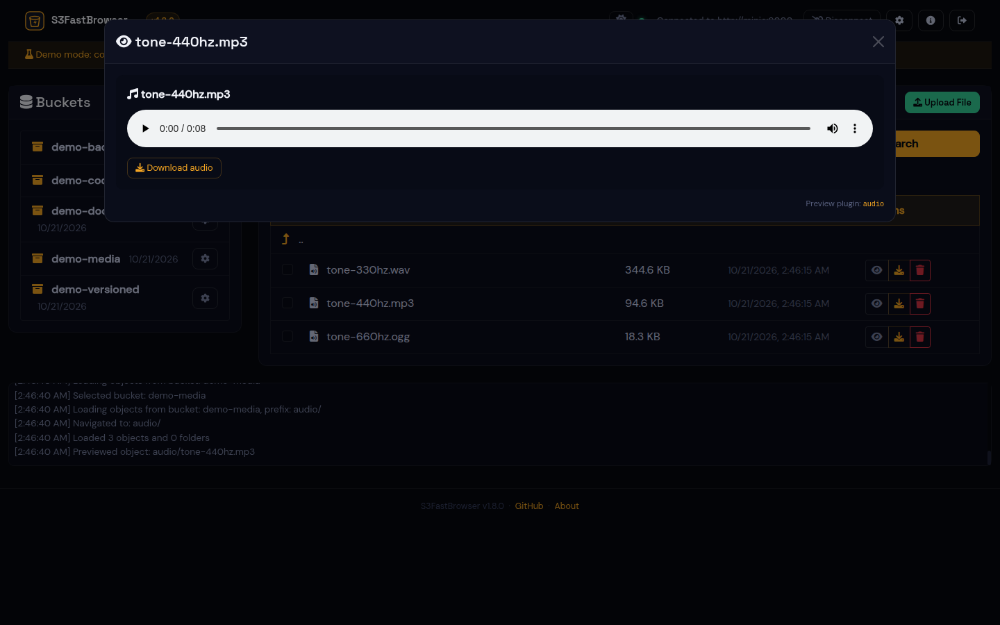
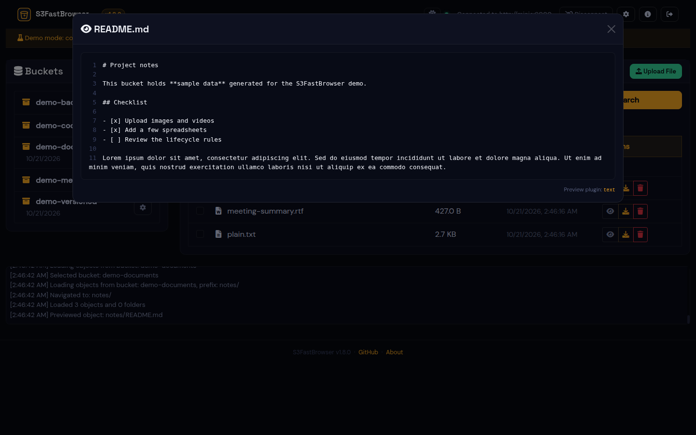
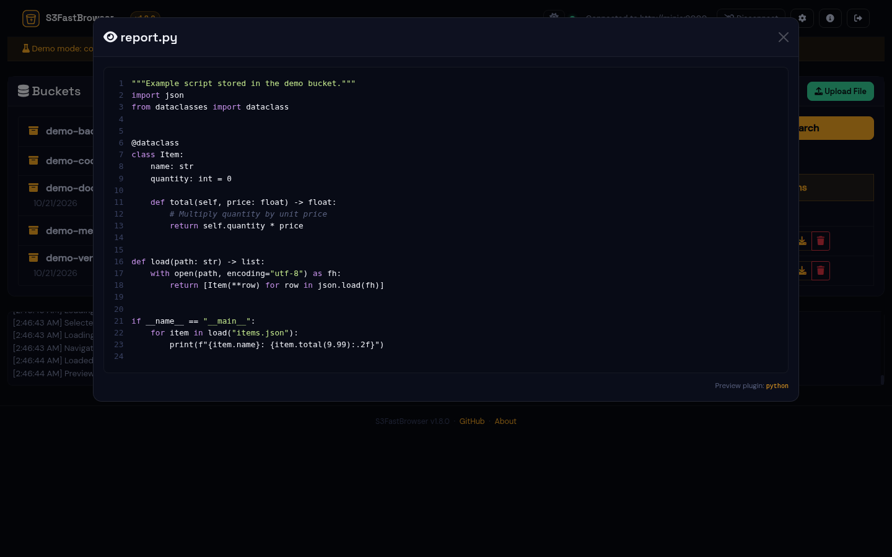
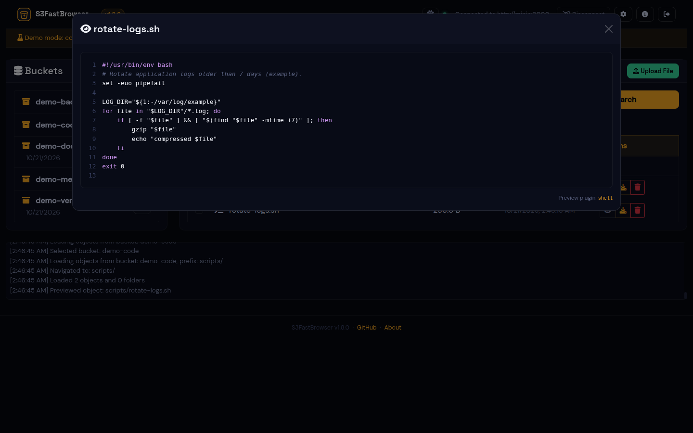
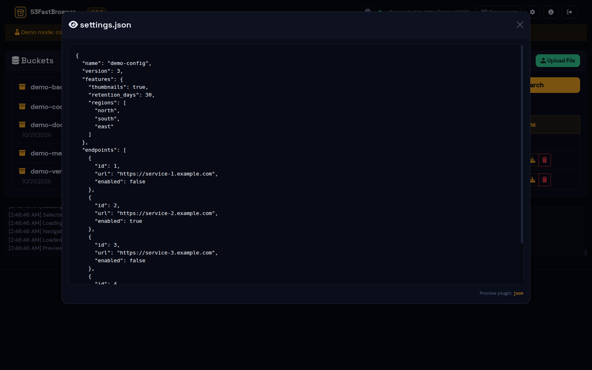
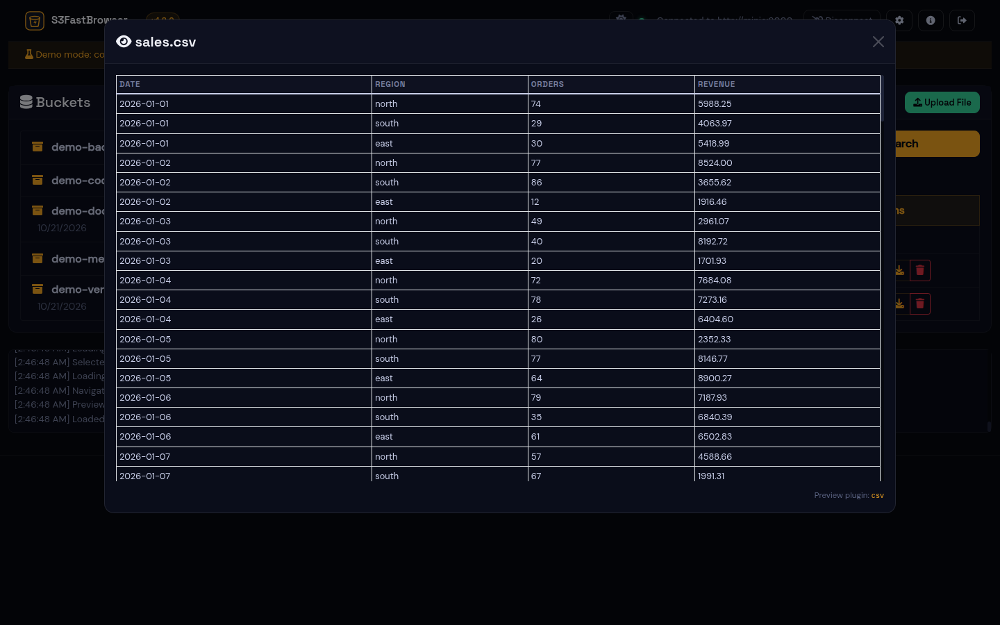
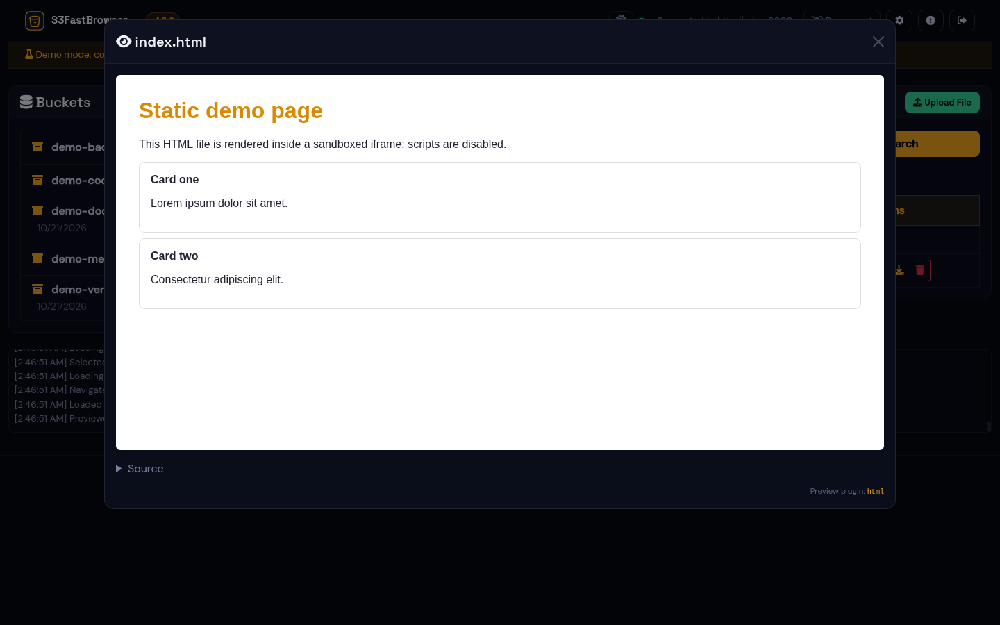
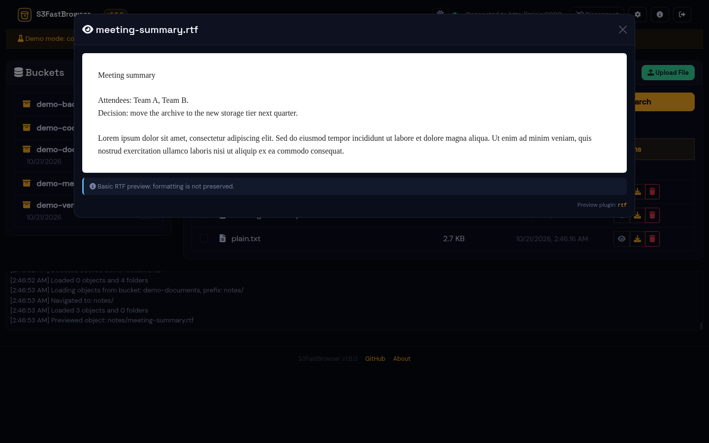
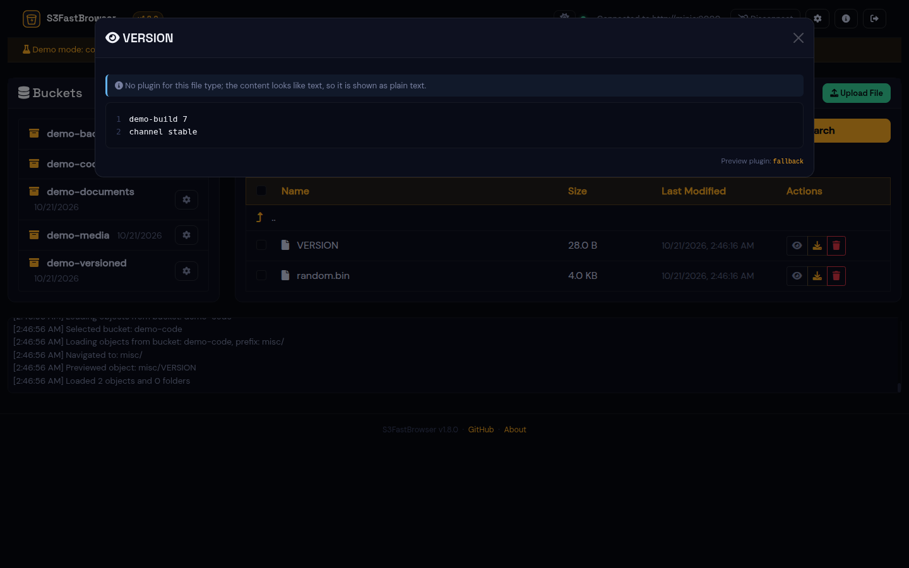
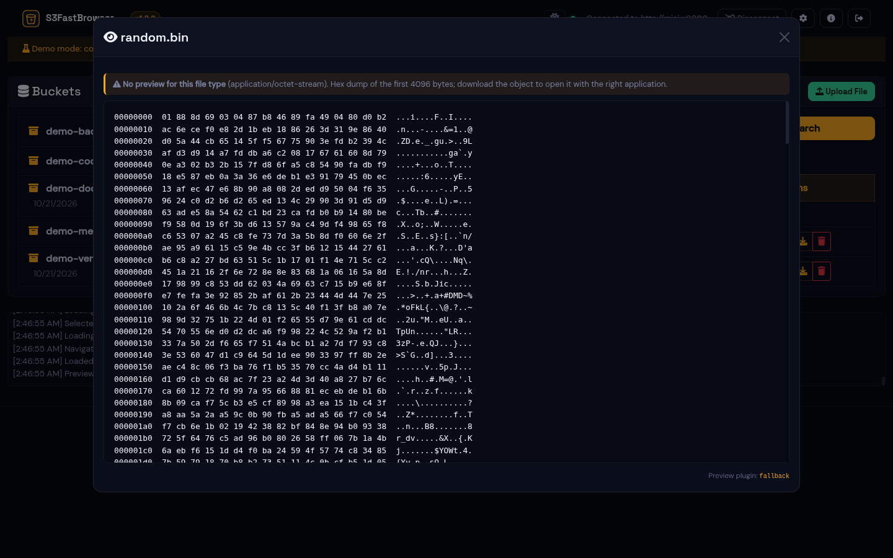

# Supported previews

The preview dialog (eye icon next to every object) uses the first
[preview plugin](PLUGINS.md) that accepts the object. This page shows each one with
the demo data (all files are generated; see [README](../README.md#demo-mode)).

| Type | Extensions / content types | Plugin | Limits |
|---|---|---|---|
| [Images](#images) | jpg, jpeg, png, gif, webp, bmp, svg, avif, ico, `image/*` | `image` | up to `S3FB_PREVIEW_MAX_MB` (25 MB) |
| [PDF](#pdf) | pdf | `pdf` | streamed, any size |
| [Video](#video) | mp4, m4v, webm, mov, mkv, ogv, `video/*` | `video` | streamed with seeking; codec support depends on the browser |
| [Audio](#audio) | mp3, wav, ogg, oga, opus, flac, aac, m4a, weba, `audio/*` | `audio` | streamed with seeking |
| [Text and Markdown](#text-and-markdown) | txt, log, md, rst, xml, yml, yaml, toml, ini, cfg, conf, env, properties, sql, js, ts, css, go, rs, java, c, cpp, cs, rb, php, ... and `text/*` | `text` | first 100 KB |
| [Python](#python) | py, pyw, pyi | `python` | first 512 KB |
| [Shell scripts](#shell-scripts) | sh, bash, zsh, fish, csh, tcsh, ksh, dash | `shell` | first 100 KB |
| [JSON](#json) | json, geojson, jsonl, ndjson | `json` | up to 5 MB (then plain text) |
| [CSV / TSV](#csv) | csv, tsv | `csv` | first 100 KB, 200 rows |
| [Excel](#excel) | xlsx, xlsm | `xlsx` | 10 sheets x 200 rows x 50 columns; up to `S3FB_PREVIEW_MAX_MB` |
| [HTML](#html) | html, htm | `html` | first 512 KB, sandboxed (no scripts) |
| [RTF](#rtf) | rtf | `rtf` | first 2 MB, text only |
| [Anything else](#anything-else) | all other files | `fallback` | text detection on the first 100 KB, otherwise hex dump of 4 KB |

Not previewed (they fall back to a hex dump; download them instead): Word and
PowerPoint documents, legacy `.xls`, archives (zip, tar, 7z), and other binary
formats. You can add support for them with a [plugin](PLUGINS.md#writing-a-plugin).

## Images

## PDF

The browser's built-in PDF viewer, with buttons to download the file or open it in a
new tab. Browsers without a PDF viewer offer the file as a download.

## Video

## Audio

## Text and Markdown

Markdown is shown as source (with line numbers). For rendered Markdown see the example
plugin in [PLUGINS.md](PLUGINS.md#writing-a-plugin).

## Python

## Shell scripts

## JSON

## CSV

## Excel

## HTML

The page is rendered in a sandboxed iframe: scripts, forms and plugins are disabled
and it cannot access S3FastBrowser. The source is available below the frame.

## RTF

## Anything else

Files without a matching plugin are inspected: if the first bytes look like text they
are shown as text (left), otherwise as a hex dump (right).

| Detected as text | Binary |
|---|---|
|  |  |
